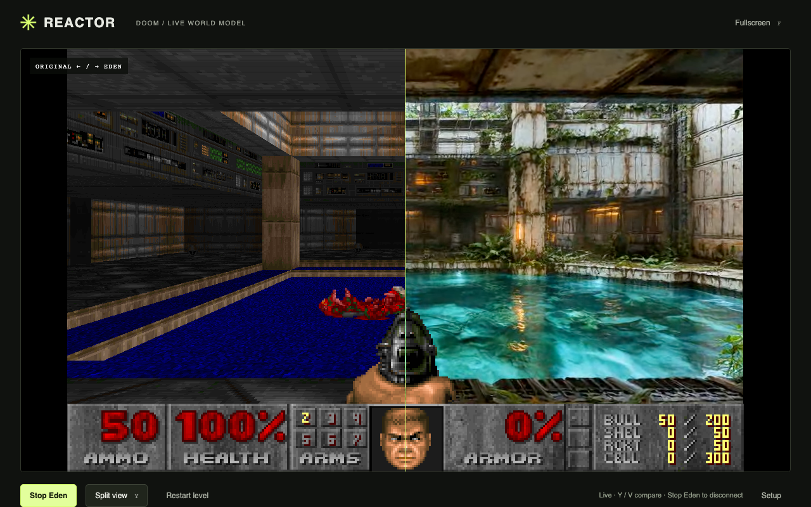

# DOOM × EdenLive

Play Doom on a Steam Deck while [Reactor EdenLive](https://docs.reactor.inc/model-api-reference/eden-live/overview) transforms the world in real time. Doom runs locally in Three.js. Eden inference runs in the cloud. Movement, collisions, enemies, weapons, sound, menus and the HUD remain owned by the original game.

The intended demo is an over-the-shoulder shot of a real person playing on a real Deck, with a button press switching between the original and the generated world. No prerecorded output or simulated AI mode is included.



Actual cloud smoke-test screenshot from Chromium on a development computer. This is not a Steam Deck hardware result.

## Run on your computer

Requires Node.js 22.14+ and npm. The source is pinned and included, so there is no separate Doom install or CDN dependency.

```sh
git clone https://github.com/willemhelmet/eden-live-doom-three-js.git
cd eden-live-doom-three-js
cp .env.example .env
# Edit .env and add REACTOR_API_KEY. Use the endpoint matching your key.
npm ci
npm run build
npm start
```

Open **http://127.0.0.1:3210/**, using that exact host. Original Doom is available without a key. **Start Eden** creates one cloud session; **Stop Eden** disconnects it and restores the original. **Restart level** disconnects first and reloads E1M1. Hiding the page requests a disconnect, and closing it drops its connection; use Stop Eden for confirmed cleanup before ending a take. The platform token additionally caps the session at 15 minutes. Cloud usage is billed to your Reactor account.

For development: `npm run dev`. The same Node server serves Vite and the token endpoint. There is no public token broker, queue or deployment to configure.

## Steam Deck: Desktop Mode first

1. Switch the Deck to Desktop Mode. Install **Chromium** from Discover if you do not already have Chromium or Chrome.
2. Clone this repository in Konsole into a directory you control, such as `~/Games/eden-live-doom-three-js`.
3. Run:

   ```sh
   cd ~/Games/eden-live-doom-three-js
   bash scripts/deck.sh
   ```

4. On first run the launcher creates `.env`. Edit that file with your Reactor API key, then close the launcher and run it again. Use `REACTOR_API_URL=https://api.rea.live` only if you are using a dev key; otherwise keep the default production endpoint.
5. The launcher installs a portable Node 24 LTS runtime inside `.runtime/` if needed, verifies its SHA-256 against Node's official manifest, installs the locked npm packages and builds the app. It never needs `sudo`, writable SteamOS system partitions or a global Node install. Initial setup requires internet. Eden also requires internet while playing.
6. Chromium opens in its own kiosk profile. Use the small **•••** button in the top right to reveal setup/connection controls, or R3 to leave theater mode. Exit the browser with Alt+F4 or Steam's shortcut close control. Closing the browser also stops the local server. Logs are in `.runtime/server.log`.

Keep this repo in a path the browser can access. The Flatpak launch grants device and `/run/udev` access for the controller for that invocation. For manual browser launch, run `bash scripts/deck.sh --no-browser` and keep the terminal open.

### Add to Steam Gaming Mode

In Desktop Steam, choose **Games → Add a Non-Steam Game → Browse** and add `/usr/bin/bash`. Set the shortcut name to **Reactor / Doom** and its properties to:

```text
Target:         /usr/bin/bash
Start In:       /home/deck/Games/eden-live-doom-three-js
Launch Options: "/home/deck/Games/eden-live-doom-three-js/scripts/deck.sh"
```

Adjust both paths to your actual checkout. Leave compatibility/Proton disabled: this is a native Linux launcher. Select a **Gamepad With Joystick Trackpad** Steam Input template. The app reads the standard browser Gamepad API; a keyboard-and-mouse template will not exercise the analog adapter. Return to Gaming Mode and launch the shortcut. If inputs do not appear, check Chromium's gamepad access and try Desktop Mode to separate browser permissions from Steam Input configuration.

Physical Deck hardware, Gaming Mode and the Flatpak path still require a check on the target device. Browser automation on another machine cannot establish those results.

## Controls

| Action | Steam Deck / standard gamepad | Desktop |
| --- | --- | --- |
| Move / strafe | Left stick | WASD |
| Turn | Right stick horizontal | Mouse, left/right arrows |
| Fire | RT | Left mouse / Ctrl |
| Use / open door | A | Space |
| Run | LT or L3 | Shift |
| Previous / next owned weapon | LB / RB | Number keys |
| Start / stop Eden | X | On-screen button |
| Original ↔ Eden | Y | View button |
| Cycle original / Eden / split | View | V |
| Doom menu / pause | Menu or B | Escape |
| Menu selection | D-pad + A | Arrows + Enter |
| Fullscreen / return to controls | R3 | F |

Doom's original view has no vertical look. The adapter uses a slow filming pace: walking, strafing and camera turning run at roughly one quarter of their original speed for keyboard, mouse and gamepad. Run still gives a relative boost. The game continues at its original 35 Hz simulation rate. Pace multipliers are in `src/deck-input.mjs`. Stick drift has a deadzone. Keyboard and gamepad input compose; disconnecting the controller returns its axes and buttons to neutral.

## Appearance and first frame

Open **Setup** to edit the prompt and reference image. The default is a bundled **orbital greenhouse** appearance image, generated from the exact world-only E1M1 opening composition using the built-in image-generation tool. It changes the materials, lighting and vegetation while retaining the room's geometry. Its [prompt](docs/appearance-reference-prompt.md) is included. Choose **Current Doom frame** to use a live snapshot, or upload your own image. Changes apply to the next cloud connection; the running app makes no image-generation API calls.

The app suspends local play during connection and staging, publishes the local world at a target 24 fps, selects `source=client`, pauses the model, uploads/stages the reference, sets the prompt, then starts. It reveals `main_video` only after the model reports a completed chunk and the browser decodes a nonblack frame, then resumes local play. The original weapon and HUD are composited above the generated world. Menus and automap show the original game so they stay usable. Restart the level before a new take to align with the bundled opening reference.

Y / V changes what you see; it does not change the capture source. The generated output never feeds back into Eden. Keep turns slow for the filmed take: local controls remain responsive, but generated visuals arrive later and may drift over time. There is no claim of measured end-to-end latency or long-session stability.

## Film the demo

See [the short shot list and caption draft](docs/filming.md). No social account is connected and nothing is posted by this project.

## Validation

```sh
npm test
npm run build
npx playwright install chromium       # Once, only for browser tests
npm run test:browser
```

Unit tests cover analog input, credential isolation, token scope, cancellation and cleanup. Browser tests boot the real bundled Doom at 1280×800, inspect actual rendered pixels, move the real player with keyboard and an emulated standard gamepad, verify release, and exercise no-key failure/restart. They do not call the cloud. An existing Chromium binary can be selected through `PLAYWRIGHT_CHROMIUM_EXECUTABLE_PATH`.

See [VALIDATION.md](VALIDATION.md) for the actual run results and outstanding device checks.

## Source and licensing

The pinned [mrdoob/three-doom](https://github.com/mrdoob/three-doom) port is included under its stated GPL v2 code license; this demo's source is GPL-2.0-only. See [LICENSE](LICENSE) and [THIRD_PARTY_NOTICES.md](THIRD_PARTY_NOTICES.md) for source provenance, the small adapter patches and asset boundaries. The included `doom1.wad` is the upstream shareware Episode 1 asset, separate from the code license. No registered Doom assets are included. Reactor's hosted service and npm SDK dependencies have their own terms/licenses.
